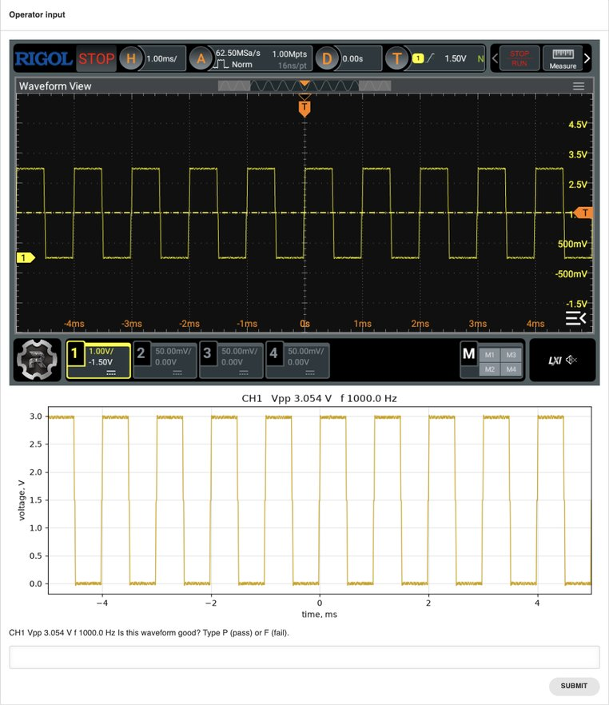
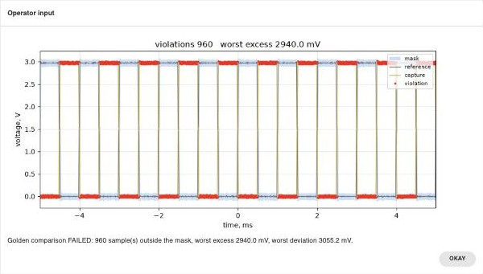

# Examples

## operator_demo.py

An OpenHTF station with the web GUI: it sets the scope up from `captures/clock.yaml`, captures channel 1,
shows the waveform to the operator and records the operator's PASS / FAIL.



```bash
.venv/bin/python examples/operator_demo.py --fake                                    # no hardware
.venv/bin/python examples/operator_demo.py                                           # scope on USB
.venv/bin/python examples/operator_demo.py --resource TCPIP::192.0.2.10::5555::SOCKET
```

Open `http://<address of this machine>:4444` (the server listens on all interfaces).

1. Enter a DUT id. The test starts.
2. The scope's screen appears with the plotted waveform (Vpp and frequency in its title) below it, in one picture.
3. Type `P` or `PASS`, `F` or `FAIL`. Anything else is asked again.
4. The result is shown in the GUI and the next test waits for a DUT id. `--once` stops after one test.

What is recorded per test, in `examples/results/<dut>.<time>.json`:

| Measurement | Meaning | Limit |
|---|---|---|
| `vpp` | peak-to-peak voltage | none, informational |
| `frequency` | from rising edges, with hysteresis | none, informational |
| `num_points` | samples read | none |
| `operator_verdict` | the operator's answer | must be `PASS` |

Attachments: `waveform.png` (the plot), `screen.png` (the scope screen, taken after the read and before the scope
is set running again; the picture the operator saw is these two stacked, not attached) and `waveform.npz` (16-bit raw samples plus the
preamble, from which volts and time can be rebuilt).

The scope is returned to the state it was found in after every test.

Checked on 2026-09-28 from a browser on another machine, with the fake and with the real DHO814: a FAIL
answer, a PASS answer and a wrong answer that is asked again.
With the scope screen in the prompt (picture above, 2026-09-28): run on the real DHO814 with
`tools/operator_robot.py` in place of the operator, and looked at in Chrome on another machine. The prompt
image is 1024 x 1020, 154 KB as base64; in a window 1400 x 860 the picture, the question and the answer field
fit without scrolling. Verdict PASS, scope restored.

Options: `--port N` (default 4444), `--once`, `--fake`, `--resource NAME`.
Requires `matplotlib` in addition to the project's packages.

## golden_demo.py

Same idea as `operator_demo.py`, but the verdict comes from `golden.py` (a voltage/time mask around a
reference) instead of an operator.

```bash
.venv/bin/python examples/golden_demo.py teach --fake -n 10 --golden golden/clock.npz   # no hardware
.venv/bin/python examples/golden_demo.py teach -n 10 --golden golden/clock.npz          # scope on USB
.venv/bin/python examples/golden_demo.py run --golden golden/clock.npz                  # web GUI, port 4444
```

`teach` applies `captures/clock.yaml`, takes `n` single captures (default 10), builds a golden reference
and mask and saves `golden/clock.npz` plus `golden/clock.npz.png` (reference + mask, no capture overlaid).
It prints the tolerance it chose and the worst deviation seen while teaching, and leaves the scope as found.

`run` is an OpenHTF station like `operator_demo.py`: it applies the capture file, takes one capture, and
compares it with the golden file (`golden.compare()`). Measurements: `mask_violations` (must be 0),
`worst_excess` and `worst_deviation` (volts, informational), `vpp` and `frequency` (informational).
Attachments: `comparison.png` (mask, reference, capture, violations in red) and `waveform.npz`. A missing
golden file is refused before the station starts, telling you to run `teach` first.

`--show-failures` adds a phase that shows `comparison.png` to the operator (acknowledge only) when, and
only when, the comparison failed; it records nothing and cannot change the PASS/FAIL result.
`--fake-defect shift|gain|glitch` (with `--fake`) injects a bad-unit fault into the fake scope, to exercise
a FAIL without hardware.

Options: `--port N` (default 4444), `--once`, `--show-failures`, `--fake`, `--fake-defect NAME`,
`--resource NAME`, `--capture PATH`, `--golden PATH`; `teach` adds `-n N`, `--v-tol VOLTS`, `--t-tol SAMPLES`.

### Checked on the real scope (2026-09-28)



- Golden taught from 10 captures of the probe-compensation square wave: tolerance chosen 67 mV, 2 samples.
- 40 further good captures: 0 failures, worst deviation from the reference 58 mV.
- Capturing on the falling edge instead of the rising edge: FAIL, 960 of 1000 samples outside the mask.
- Trigger level moved from 1.5 V to 2.8 V: FAIL, 1 sample outside the mask.
- Time base offset changed, or vertical scale so small that the signal clips: refused (`GoldenMismatch`),
  the phase ends with outcome ERROR. ERROR means the measurement is not valid, not that the unit is bad.
- A different vertical scale without clipping (2 V/div): PASS. The comparison is done in volts.
- `tools/operator_robot.py` plays the operator against a running station (it reads the feed the web GUI
  reads and answers prompts), for checks without a browser.

The golden file in `golden/clock.npz` belongs to this scope, this probe and `captures/clock.yaml`.
